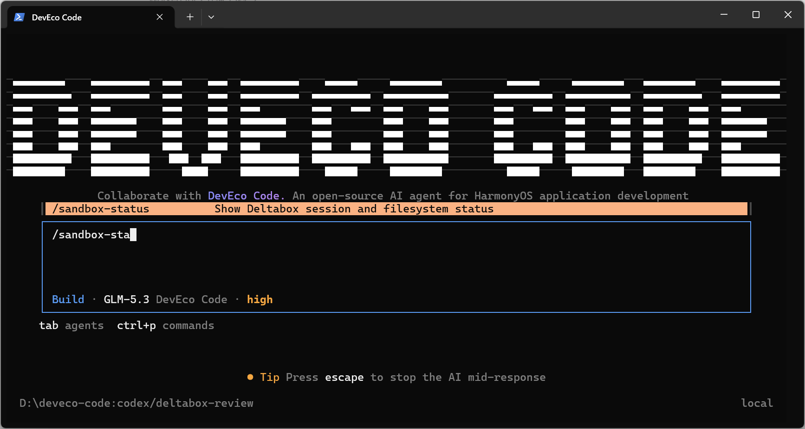
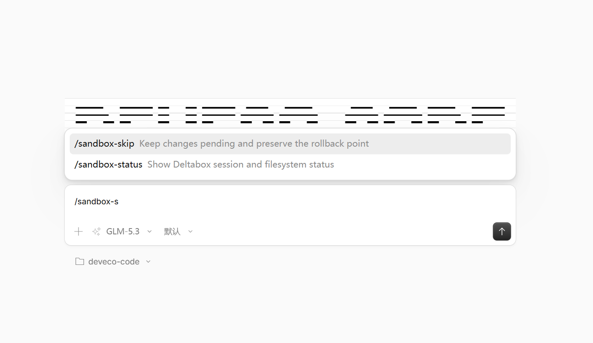
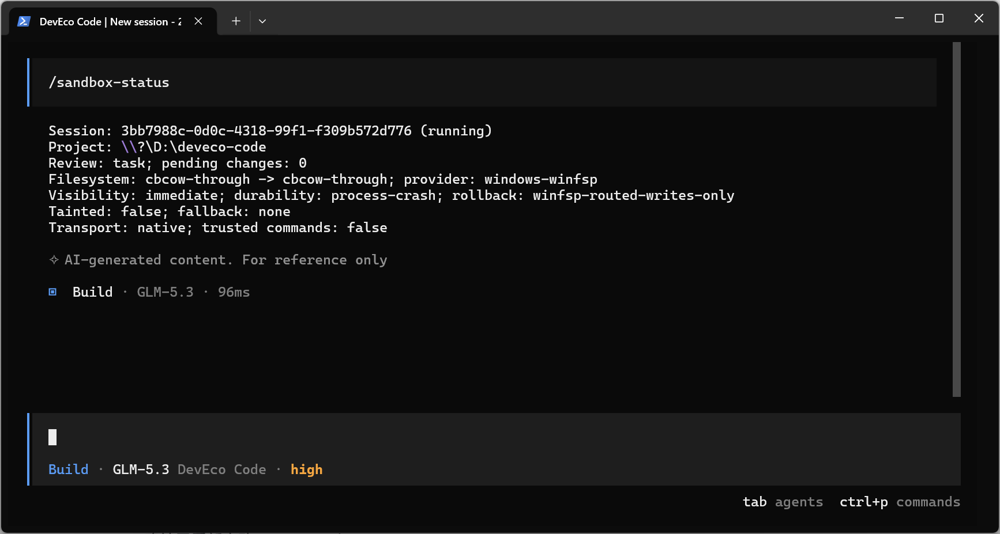
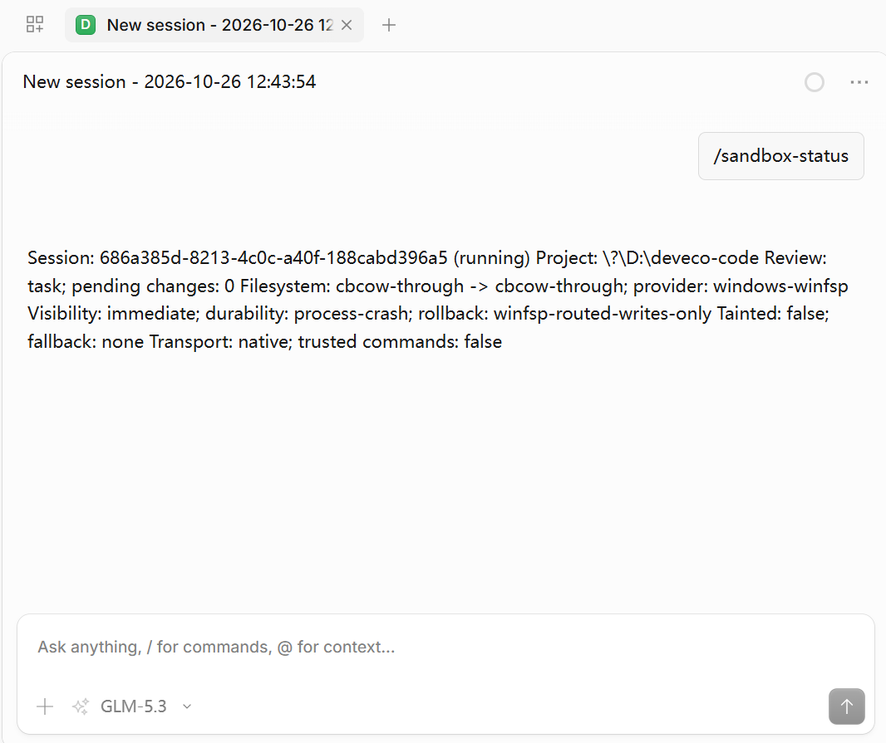
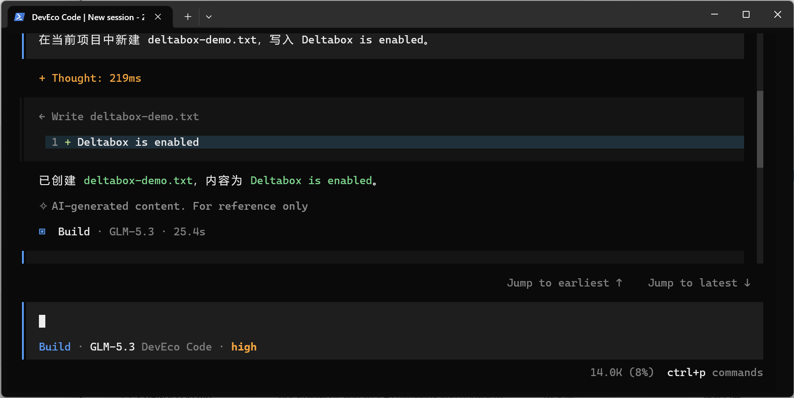
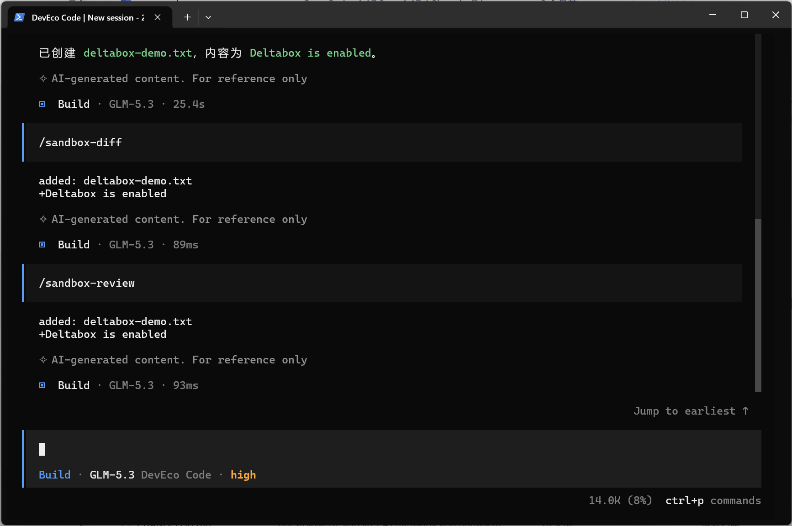
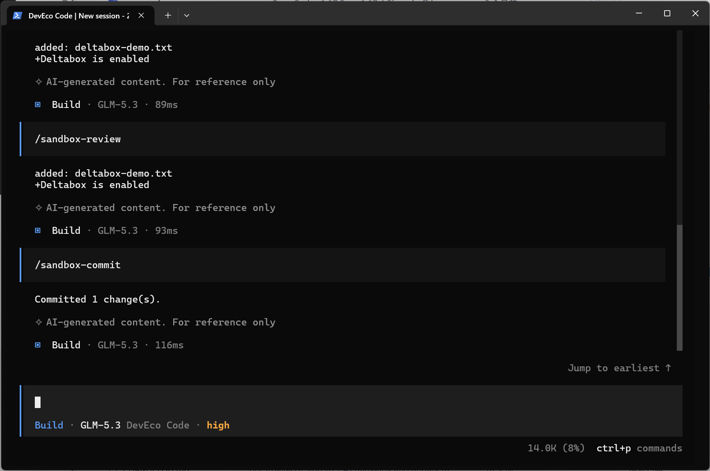
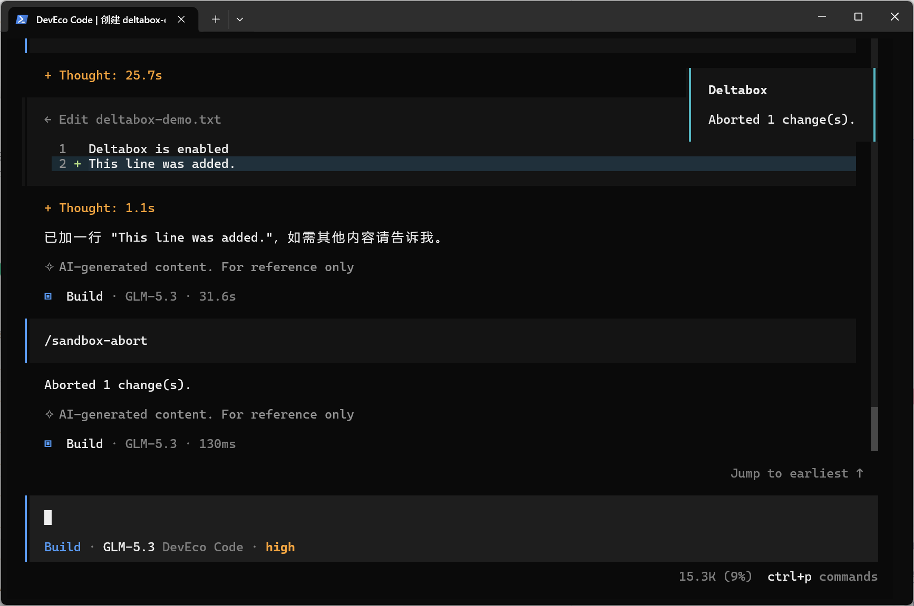
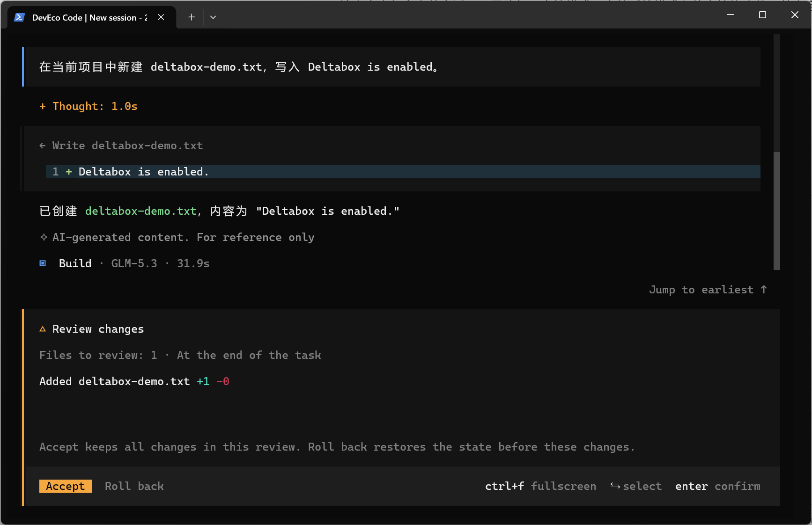
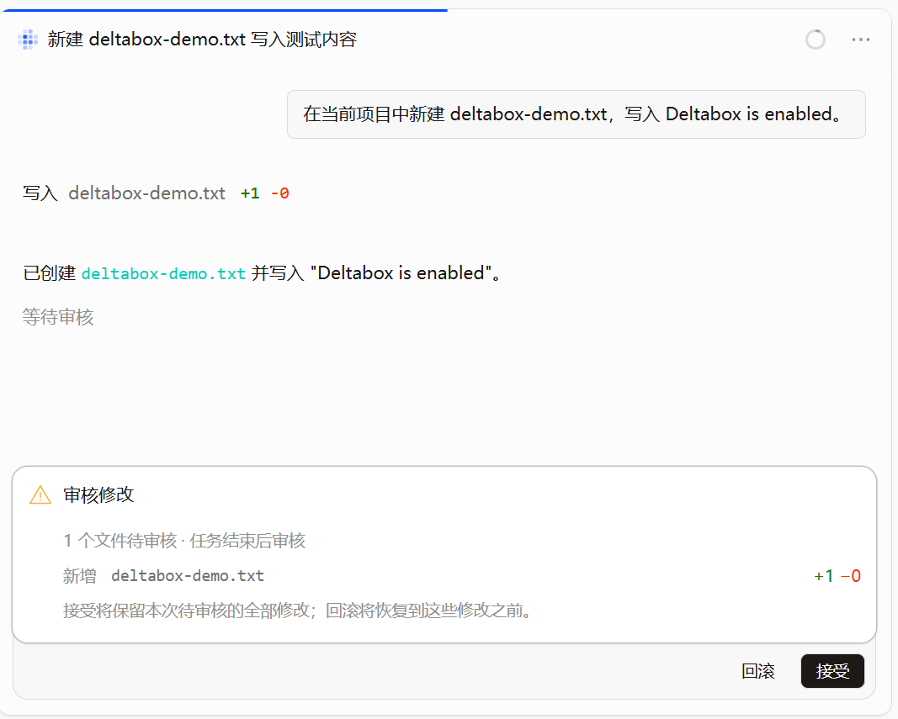

# Deveco DeltaboxLite Integration Guide

English | [简体中文](deltabox.zh-CN.md)

> Code: [DevEco Code MR !1334](https://gitcode.com/openharmony-sig/deveco-code/merge_requests/1334)

DeltaBox Lite is a lightweight filesystem runtime designed for AI agents. It provides change comparison, commit and rollback of filesystem state, and filesystem isolation.

The `deveco-deltabox` plugin takes over Deveco's built-in file read/write, editing, search, patch and shell tools. It directs changes to a dedicated DeltaBox Lite workspace to provide these comparison, commit and rollback capabilities.

With the plugin enabled, DevEco Code lists the changes made during each conversation turn when the turn finishes. You can accept all changes through commands or restore the project files to their state before the turn.

## Requirements

- Install [WinFsp](https://winfsp.dev) before using the Windows version.

- No additional applications are required for the macOS version.

## Quick start

### Enable Deltabox

Add the following configuration to `deveco.jsonc` in the project root:

```jsonc
{
  "deltabox": true,
}
```

To enable it for all projects, edit the user configuration instead:

```text
~/.config/deveco/deveco.jsonc
```

After changing the configuration, fully quit and restart DevEco Code.

### Check whether it is enabled

After installing and enabling DeltaBox, use the following command to check that installation succeeded.

Run this inside your project:

```text
/sandbox-status
```









The output should include the current session, project path, review mode, filesystem mode and number of pending changes. On the first start, the number of pending changes should be `0`.

### Disable Deltabox

Before disabling it, accept or roll back all pending changes. Then change the configuration to:

```jsonc
{
  "deltabox": false,
}
```

Restart DevEco Code for the configuration to take effect.

## Modes

### Filesystem modes

DeltaBox Lite supports three filesystem modes.

| Mode            | Visibility of pending changes   | Behavior                                                                                                                      |
| --------------- | ------------------------------- | ----------------------------------------------------------------------------------------------------------------------------- |
| `cbcow-through` | Immediately visible to the host | Modifies the project directly and records rollback data. Acceptance is fast, but other processes can see pending changes.     |
| `cbcow-private` | Hidden until accepted           | Modifies a private view. Only modified paths are published on acceptance. Requires native filesystem support on the platform. |
| `copy-private`  | Hidden until accepted           | Copies the project to a private workspace. Offers broader compatibility, but copying large projects costs more.               |

The default mode is `cbcow-through`. In this mode, the agent's changes take effect in the host workspace immediately. In the other two modes, the agent writes to a private workspace managed by DeltaBox Lite, and changes reach the host workspace only after they are committed.

### Durability levels

- `fast`: The default. Reduces synchronous write overhead for better performance.

- `strict`: Adds transaction mechanisms for stronger consistency guarantees. Supported only on some platforms and in native CB-CoW modes.

## Common commands

| Command                         | Purpose                                                                                 |
| ------------------------------- | --------------------------------------------------------------------------------------- |
| `/sandbox-status`               | Shows session, filesystem and pending-change status.                                    |
| `/sandbox-review`               | Shows all pending changes without accepting or rolling them back.                       |
| `/sandbox-diff [from] [to]`     | Shows differences between checkpoints. The arguments are optional.                      |
| `/sandbox-commit`               | Accepts all pending changes.                                                            |
| `/sandbox-abort`                | Rolls back project-file changes within the current review scope.                        |
| `/sandbox-skip`                 | Defers the decision, preserving pending changes and the original rollback point.        |
| `/sandbox-mode task`            | Reviews changes together when the root task finishes. This is the default.              |
| `/sandbox-mode tool`            | Reviews actual file changes after a modifying tool runs.                                |
| `/sandbox-mode risky`           | Reviews actual file changes after a risky tool runs.                                    |
| `/sandbox-confirmation command` | Uses commands such as `/sandbox-commit` to handle changes after each conversation turn. |
| `/sandbox-confirmation dialog`  | Shows an approval dialog at the end of a conversation turn or tool call.                |

## Usage example

Send DevEco Code a task that modifies project files. For example:

```text
Create deltabox-demo.txt in the current project and write Deltabox is enabled.
```



When the task finishes, inspect workspace changes with:

```text
/sandbox-review
```

Or run:

```text
/sandbox-diff
```



Run `/sandbox-commit` to keep the changes made during this turn.



Run `/sandbox-abort` to undo the changes made during this turn.



Run:

```text
/sandbox-confirmation dialog
```

This switches to dialog confirmation. When the model finishes its response for the current turn, the interface displays “Review changes”.





Click “Accept” to keep all project-file changes made during this turn. Click “Roll back” to restore the project files affected by this turn's changes.

## Advanced configuration

Place advanced settings in `deltabox.json` in the project root. You can also use the user configuration:

```text
$XDG_CONFIG_HOME/deveco/deltabox.json
```

If `XDG_CONFIG_HOME` is not set, the default path is `~/.config/deveco/deltabox.json`.

DevEco Code reads the user configuration first, followed by the project configuration. Project settings override user settings with the same field names.

### Complete defaults

The defaults for `deltabox.json` are:

```jsonc
{
  "transport": "native", // Uses Node-API communication (recommended for speed)
  "bin": "deltabox", // Executable; resolves to the bundled program by default, or specify a custom path
  "nativeAddon": null, // Custom Node-API addon (.node) path; bundled, so no change is needed
  "policy": null, // Sandbox policy for file access, network and resource limits; null uses the runtime default
  "stateDir": null, // Persistent sessions, checkpoints, logs and rollback data; null uses the runtime default location
  "runtimeDir": null, // Runtime directory for temporary workspaces and other resources; null uses the runtime default location
  "trusted": false, // false enables command isolation; true uses the host execution environment in native mode, without automatically accepting changes
  "timeoutMs": 660000, // Timeout for cli/serve modes; not applicable to this plugin
  "filesystem": {
    "mode": "auto", // Filesystem mode
    "require": false, // Whether the requested filesystem mode is mandatory
    "durability": "fast", // Durability policy
    "groupCommitMs": null, // Batches durability synchronization for multiple writes within this interval, in milliseconds
  },
  "review": {
    "mode": "task", // task: end of turn; tool: after modifying tools; risky: same as tool in the current adapter
  },
}
```

### Configure review timing

`review.mode` supports these values:

| Value   | Behavior                                                                                                                          |
| ------- | --------------------------------------------------------------------------------------------------------------------------------- |
| `task`  | Reviews changes together when the root task finishes. Shows one review after the model, tools and foreground child agents finish. |
| `tool`  | Checks differences after each tool that could modify the project. Shows a review when actual changes exist.                       |
| `risky` | Reviews at risky-tool boundaries. The current implementation uses the same boundaries as `tool`.                                  |

For example, to review immediately after each modification:

```jsonc
{
  "review": {
    "mode": "tool",
  },
}
```

You can also run `/sandbox-mode task|tool|risky` in the current session. This command does not modify configuration files.

### Configure the filesystem mode

`filesystem.mode` supports these values:

| Value           | Visibility of pending changes   | Behavior                                                                                                                      |
| --------------- | ------------------------------- | ----------------------------------------------------------------------------------------------------------------------------- |
| `auto`          | Depends on the selected mode    | Lets Deltabox choose an available mode, allowing fallback if unavailable. Use `/sandbox-status` to check the actual mode.     |
| `cbcow-through` | Immediately visible to the host | Modifies the project directly and records rollback data. Acceptance is fast, but other processes can see pending changes.     |
| `cbcow-private` | Hidden until accepted           | Modifies a private view. Only modified paths are published on acceptance. Requires native filesystem support on the platform. |
| `copy-private`  | Hidden until accepted           | Copies the project to a private workspace. Offers broader compatibility, but copying large projects costs more.               |

`filesystem.require` controls fallback:

- `false`: Allows Deltabox to fall back to another mode if the requested mode is unavailable.

- `true`: Fails startup if the requested mode is unavailable. Deltabox does not fall back.

`filesystem.durability` controls the durability level:

- `fast`: The default. Reduces synchronous writes while retaining standard session recovery.

- `strict`: Adds transaction mechanisms for stronger consistency. Supported only on some platforms and in native CB-CoW modes.

`filesystem.groupCommitMs` accepts a positive integer or `null`, in milliseconds. When enabled, it allows durability synchronization operations for multiple writes, such as `fsync`, to be batched within the specified interval, reducing disk synchronization overhead.

## Limitations

- Enabling the plugin disables built-in Git snapshots.

- Shell commands must run in the foreground, with a maximum runtime of 600 seconds.

- The shell does not support PTY, standard input or background jobs.

- The Windows shell uses PowerShell syntax. macOS and Linux use Bash syntax.
